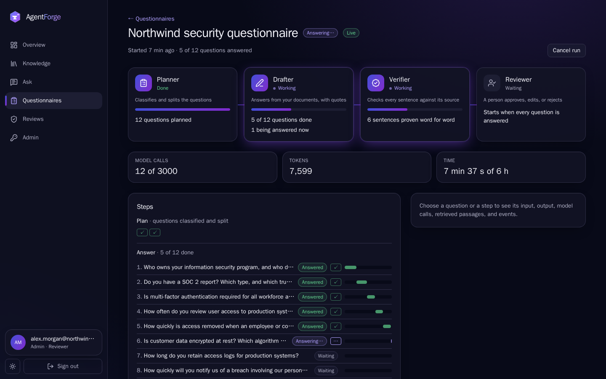
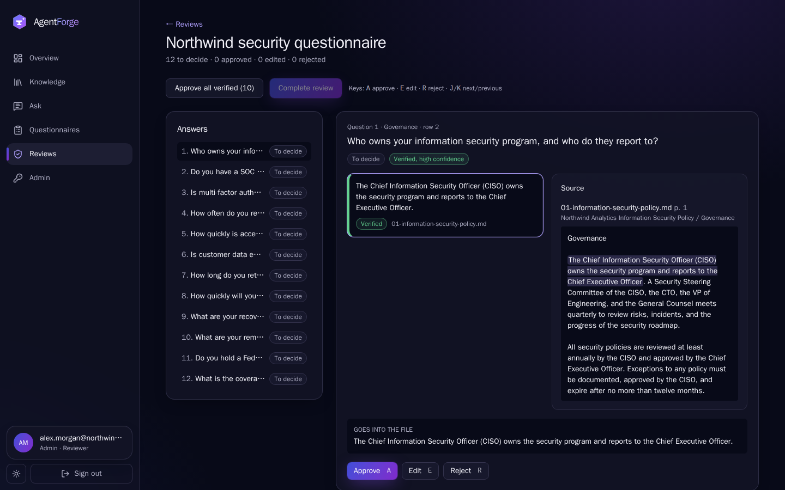

## The problem

Security questionnaires, RFPs and due-diligence checklists ask the same hundred questions in a
different spreadsheet every time. The answers are already in a company's policies, but finding
and copying them takes days. A generic AI chatbot answers fast, and confidently invents a
certification you do not have.

## The approach

- Answer **only** from your own uploaded documents.
- Back every sentence with a **verbatim quote** from a source, and drop any sentence that can't
  be proven.
- Return **"insufficient evidence"** instead of guessing.
- A **person reviews and approves** each answer before it goes out.
- Run fully self-hosted on a **CPU-only laptop** with an open-weight model (Ollama,
  `qwen3:4b`): no paid API, and no document leaves the machine.

## Architecture

<figure class="diagram">

<svg viewBox="0 0 760 240" role="img" aria-labelledby="arch-title arch-desc">
<title id="arch-title">AgentForge architecture</title>
<desc id="arch-desc">The browser talks to a Next.js web app, which calls a FastAPI API. MCP clients with an API key also call the API. The API and a DBOS durable-run worker both use Postgres 18 with pgvector and forced row-level security, and both call a local Ollama model.</desc>
<defs><marker id="arrow" viewBox="0 0 10 10" refX="9" refY="5" markerWidth="7" markerHeight="7" orient="auto-start-reverse"><path d="M0 0L10 5L0 10z" class="d-arrowhead"/></marker></defs>
<g class="d-lines" marker-end="url(#arrow)">
<line x1="160" y1="48" x2="206" y2="48"/>
<line x1="350" y1="48" x2="396" y2="48"/>
<line x1="600" y1="48" x2="544" y2="48"/>
<line x1="430" y1="76" x2="336" y2="146"/>
<line x1="400" y1="183" x2="354" y2="183"/>
<line x1="540" y1="183" x2="596" y2="183"/>
<line x1="510" y1="76" x2="614" y2="146"/>
</g>
<g class="d-box"><rect x="20" y="20" width="140" height="56" rx="10"/><text x="90" y="44">Browser</text><text x="90" y="62" class="d-sub">reviewer</text></g>
<g class="d-box"><rect x="210" y="20" width="140" height="56" rx="10"/><text x="280" y="44">Web</text><text x="280" y="62" class="d-sub">Next.js 16</text></g>
<g class="d-box"><rect x="400" y="20" width="140" height="56" rx="10"/><text x="470" y="44">API</text><text x="470" y="62" class="d-sub">FastAPI · /mcp</text></g>
<g class="d-box"><rect x="600" y="20" width="140" height="56" rx="10"/><text x="670" y="44">MCP client</text><text x="670" y="62" class="d-sub">API key</text></g>
<g class="d-box d-key"><rect x="210" y="150" width="140" height="66" rx="10"/><text x="280" y="176">Postgres 18</text><text x="280" y="194" class="d-sub">pgvector · forced RLS</text></g>
<g class="d-box"><rect x="400" y="150" width="140" height="66" rx="10"/><text x="470" y="176">Worker</text><text x="470" y="194" class="d-sub">DBOS durable runs</text></g>
<g class="d-box"><rect x="600" y="150" width="140" height="66" rx="10"/><text x="670" y="176">Ollama</text><text x="670" y="194" class="d-sub">qwen3:4b, local</text></g>
</svg>

<figcaption>A modular monolith on Postgres only: relational data, vectors, full-text search, job queues, durable-run state and the audit log live in one database.</figcaption>
</figure>

## Key decisions

Each decision has a short record (ADR) in the repo explaining the options and the trade-offs.

- **Postgres for everything.** One database instead of a vector store, a queue and a cache
  next to it: fewer moving parts to secure and run.
  ([ADR-0001](https://github.com/Kingslee1604/2026AIProjects/blob/main/agentforge/docs/adr/0001-modular-monolith-on-postgres.md))
- **Durable runs.** A crash resumes the run where it stopped instead of losing it or answering
  an item twice.
  ([ADR-0002](https://github.com/Kingslee1604/2026AIProjects/blob/main/agentforge/docs/adr/0002-durable-execution.md))
- **Forced row-level security.** The database itself keeps one tenant's data away from another,
  even if the application has a bug.
  ([ADR-0003](https://github.com/Kingslee1604/2026AIProjects/blob/main/agentforge/docs/adr/0003-shared-schema-tenancy-with-forced-rls.md))
- **Retrieval inside Postgres.** pgvector HNSW plus full-text search, merged with reciprocal
  rank fusion, behind a small retriever interface.
  ([ADR-0004](https://github.com/Kingslee1604/2026AIProjects/blob/main/agentforge/docs/adr/0004-retrieval-inside-postgres.md))
- **A thin model gateway.** Schema-constrained model output, with no LangChain or LiteLLM in
  between.
  ([ADR-0005](https://github.com/Kingslee1604/2026AIProjects/blob/main/agentforge/docs/adr/0005-thin-model-gateway.md))
- **An honest public demo.** The demo is a labelled replay of real runs, not a live model on a
  server.
  ([ADR-0009](https://github.com/Kingslee1604/2026AIProjects/blob/main/agentforge/docs/adr/0009-public-demo-is-a-replay.md))

## Measured results

All numbers come from one CPU-only laptop (Intel i7-1255U, 16 GB of RAM, no GPU). Each links to
its raw data.

| What | Result | Source |
|---|---|---|
| Retrieval, 40-question gold set | recall@5 **100%**, MRR **0.94** | [evaluation](https://github.com/Kingslee1604/2026AIProjects/blob/main/agentforge/docs/evaluation/README.md) |
| Answerable questions refused (34 answerable) | **0** | [relevance report](https://github.com/Kingslee1604/2026AIProjects/blob/main/agentforge/docs/evaluation/2026-10-16-relevance/report.md) |
| Unanswerable questions answered (6) | 2, both from a planted adversarial document, now flagged for review | [relevance report](https://github.com/Kingslee1604/2026AIProjects/blob/main/agentforge/docs/evaluation/2026-10-16-relevance/report.md) |
| Kept sentences proven by a verbatim quote | **98%** | [relevance report](https://github.com/Kingslee1604/2026AIProjects/blob/main/agentforge/docs/evaluation/2026-10-16-relevance/report.md) |
| Durability: 50 runs, worker `kill -9` 29 times, 10% model faults | **50/50** succeeded, 0 duplicate exports; recovery p50 3.1 s, p95 6.6 s | [durability.json](https://github.com/Kingslee1604/2026AIProjects/blob/main/agentforge/bench/results/durability.json) |
| Prompt injection | **0** tool executions possible | [report](https://github.com/Kingslee1604/2026AIProjects/blob/main/agentforge/docs/security/prompt-injection.md) |
| 40-question run, end to end | **37 min**, 40/40 answered, 0 timeouts | [measurements](https://github.com/Kingslee1604/2026AIProjects/blob/main/agentforge/bench/results/2026-10-19-inspiron-3520-one-at-a-time/summary.md) |
| The same run before the fix | 110 min | [report](https://github.com/Kingslee1604/2026AIProjects/blob/main/agentforge/bench/results/2026-10-19-inspiron-3520/summary.md) |

**The 3x fix, found by measuring.** The earlier default answered up to eight questions at once,
but on a CPU-only model the calls queued and timed out. Answering one question at a time
cut the 40-question run from 110 to 37 minutes.

## Screenshots

## What I'd do next

The next release (R2) adds a governed MCP client, so agents can use outside tools behind
allowlists, approval and SSRF protection; a declarative workflow spec; and an **invite-only
hosted demo**, so reviewers can try AgentForge without installing anything.
